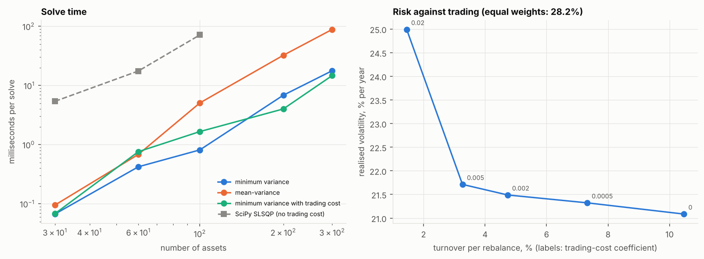

# SplitFolio

A portfolio optimiser in Rust for the problem desks actually solve: minimum risk or mean-variance, long-only, a cap
per name, and a cost for every unit traded. The method splits the problem into a linear solve and a closed-form
shrink-and-clip step, repeated until the two agree. 

## Results

| | |
|---|---|
| Optimality conditions, 15 problems up to 300 assets | violated by at most 1.2e-7 of the gradient |
| Weights against SciPy SLSQP (up to 100 assets) | within 1.7e-7 |
| 300 assets, long-only and capped: minimum variance / with trading cost / mean-variance | about 18 ms / 15 to 25 ms / 90 ms |
| Speed against SLSQP at 100 assets | 10 to 100 times faster, depending on the problem |
| Positions left exactly untouched by the trading cost (300 assets) | 115 |
| Rolling minimum-variance portfolio: realised volatility (equal weights: 28.2%) | 21.1% |
| Turnover per rebalance without and with trading cost (coefficient 0.002) | 10.5% and 4.7% |
| Volatility given up for it | 0.4 points |

9 of 9 validation checks pass (`reports/validation.md`). Full tables: `reports/report.md`.



## Reading the numbers

- The solutions are verified, not just produced: the optimality check is independent of any other solver.
- It is a first-order method. It is fast to nine digits and slow beyond; the mean-variance problem needs six times
  more iterations than minimum variance.
- The backtest measures the trade-off between risk and trading. It contains no return forecast and no cost
  accounting, and the stocks are survivors, so it says nothing about performance.

## Run

    pip install -e ".[dev]"
    make build                              # cargo build --release, no external crates
    python -m splitfolio run                # about 30 s
    python -m splitfolio run --fast
    pytest

```python
import numpy as np
from splitfolio import engine

r = engine.load_returns()[:500, :100]
cov = 252 * engine.covariance(r)
current = np.full(100, 0.01)
res = engine.solve(cov, kappa=0.002, w0=current, cap=0.05)
res["weights"], res["iterations"]
engine.kkt_violation(res["weights"], cov, np.zeros(100), 0.0, 0.002, current, 0.05)
```

## Layout

    engine/src/main.rs             Cholesky factorisation, x-step, shrink-and-clip z-step, residuals
    src/splitfolio/engine.py       wrapper, optimality check, SciPy reference, data
    src/splitfolio/pipeline.py     experiments, checks, report
    docs/methodology.md            splitting, verification, findings, limits

## Author

Amir Masominia. PhD in physics (Université Paris-Saclay); postdoctoral researcher working on machine-learning
surrogate models, numerical simulation and automated measurement pipelines.

MIT licence.
